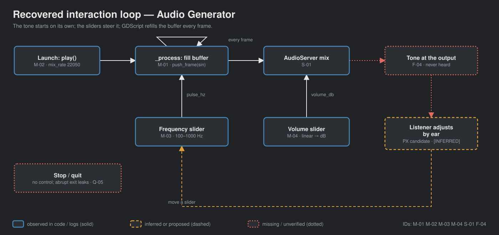
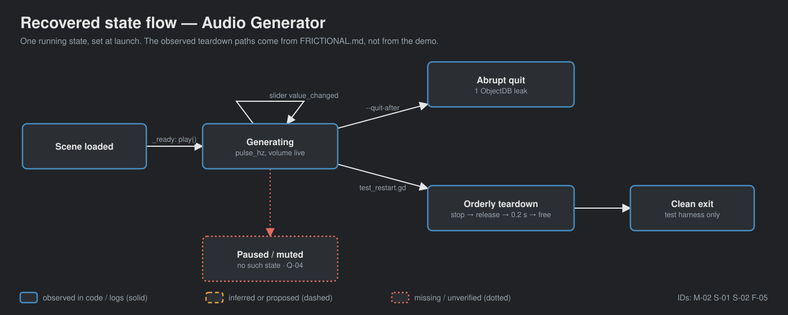

# walker-audio-generator — Game Design Document (recovered)

| | |
|---|---|
| Version | 0.1.0-recovered |
| Date | 2026-09-27 |
| Author | Recovered by Zelda (/gdd reverse --path godot silent), for Nik Bear Brown |
| Mode | recovered, silent |
| Revision | 1 |
| Gates | vision ○ · systems ○ · world ○ · scope ○ — gate — unsigned at time of writing |
| Source | title-only adaptation of the Godot demo `audio/generator`, commit a3b5c113 (Godot Engine contributors, MIT) |
| What this is | a **tech demo** of procedural audio, not a game |

Provenance tags: `[OBSERVED path:line]` the code or a local log shows this · `[INFERRED]` the code strongly implies this, evidence stated · `[MISSING]` nothing in the folder can tell us this. Paths are relative to the folder root. A recovered GDD describes what exists; it approves none of it. In the diagrams, observed elements are solid, inferred or proposed ones dashed, missing or unverified ones dotted.

No screenshot exists in this folder (`godot/screenshots/` is absent) and no local capture was made `[OBSERVED]`. The deck therefore carries diagrams only.

## 1. Vision summary

**What the code is.** A Node that fills an AudioStreamGenerator buffer every frame with a stereo sine wave, plus two HSliders: frequency (100–1000 Hz, starts 440) and volume (linear 0.001–1.0, starts 0.25 = −12.04 dB) `[OBSERVED godot/generator_demo.gd:1-43; godot/generator.tscn:45-80]`. Description: "generate and play audio samples from GDScript. It plays a simple 440 Hz sine wave at 22050 Hz" `[OBSERVED godot/project.godot:14-16]`.

**Logline.** Drag a slider, hear a tone GDScript is computing sample by sample. `[INFERRED]`

**Audience.** Godot developers learning `AudioStreamGeneratorPlayback.push_frame()` `[INFERRED godot/README.md]`. Walker audience `[MISSING]`.

**Why it exists in Walker.** Two native-4K Liam films are planned `[OBSERVED README.md]`. Purpose beyond that `[MISSING]`.

**Biggest unresolved question.** Is this a lesson about synthesis (what a sine wave is) or about the engine API (how buffers are filled)? Q-01.

## 2. Design pillars

None on record `[MISSING]`. Candidates `[INFERRED]`: P-01 the sound is computed, not loaded (no audio assets; `push_frame` loop, `generator_demo.gd:11-18`); P-02 perceptual volume (the comment at line 41 explains `linear_to_db` "matches perceptual human hearing").

## 3. Core loop

**Micro.** The tone starts on its own at launch `[OBSERVED generator_demo.gd:25-32]` → drag or key the frequency slider → pitch changes → drag the volume slider → loudness changes, label shows dB `[OBSERVED generator_demo.gd:35-43]`. Every frame `_process` refills whatever buffer space is free `[OBSERVED lines 21-22]`. Nobody has heard the result `[OBSERVED FRICTIONAL.md]`.

**Meso / macro.** None. No stop control; the tone plays until the window closes `[OBSERVED: no stop handler]`.

**Loop honesty test.** An oscillator with two knobs. Not a game `[INFERRED]`.

## 4. Player Experience Goals

None recorded `[MISSING]`. Candidate PX-01 `[INFERRED]`: the listener connects slider position to pitch. Untested.

## 5. Mechanics

### M-01 Fill the buffer `[OBSERVED generator_demo.gd:11-18]`
increment = pulse_hz / sample_hz; for every available frame, push `Vector2.ONE * sin(phase × TAU)` (identical left/right) and advance phase modulo 1.0.

### M-02 Start `[OBSERVED generator_demo.gd:25-32]`
Sets `mix_rate` to 22050 before `play()`, takes the playback, fills once. Tuning values (source, not approved design): `sample_hz` 22050, `pulse_hz` 440 `[lines 4-5]`.

### M-03 Frequency slider `[OBSERVED generator_demo.gd:35-37; generator.tscn:45-51]`
Sets `pulse_hz` and the label "%d Hz". Range 100–1000.

### M-04 Volume slider `[OBSERVED generator_demo.gd:40-43; generator.tscn:73-80]`
Sets `volume_db = linear_to_db(value)` and the label "%.2f dB". Range 0.001–1.0, step 0.001; the scene's initial −12.041 dB `[generator.tscn:12]` matches 0.25.

Edge cases: frequency changes take effect at the next buffer fill, with phase continuous (no click from a phase reset) `[INFERRED from the shared phase variable]`; underruns if `_process` stalls are unhandled `[INFERRED; never measured, FRICTIONAL.md]`.

## 6. Systems

### S-01 Generator pipeline `[OBSERVED]`
Script (phase, pulse_hz) → AudioStreamGeneratorPlayback buffer → AudioServer mix at 22050 Hz → output. Buffer length is the AudioStreamGenerator default `[INFERRED: no buffer_length in generator.tscn:5]`.

### S-02 Teardown `[OBSERVED FRICTIONAL.md 2026-09-26]`
Abrupt `--quit-after` exit leaks one `AudioStreamGeneratorPlayback` (refcount 1). An orderly stop → disable filling → release → 0.2 s drain → free sequence, in the local test only, shuts down cleanly three times. No production fix is claimed.

## 7. Progression

None `[OBSERVED]`.

## 8. World

N/A. Dark grey clear colour `Color(0.125, 0.125, 0.125)` `[OBSERVED project.godot:36]`, centred VBox of labels and sliders `[generator.tscn:15-80]`.

## 9. Narrative

N/A.

## 10. Characters

N/A.

## 11. Features and priority

| ID | Feature | Tag | Status |
|---|---|---|---|
| F-01 | Sine generation via push_frame | CORE `[INFERRED]` | exists; playback initialized, phase wrapped `[OBSERVED generator-20260924.log]` |
| F-02 | Frequency slider | CORE `[INFERRED]` | exists; keyboard End/Home/Right → 1000/100/101 Hz `[OBSERVED log]` |
| F-03 | Volume slider in dB | CORE `[INFERRED]` | exists; 1.0/0.001/0.002 conversions and labels `[OBSERVED log]` |
| F-04 | Heard pitch and waveform | CORE for the films `[INFERRED]` | not verified |
| F-05 | Clean shutdown | — | leaks on abrupt exit `[OBSERVED FRICTIONAL.md]` |
| F-06 | Stop / waveform choice / visualizer | — | absent |

**CORE percentage.** No tags on record `[MISSING]`; inferred 4 of 6 = 67%. Recorded (Q-03).

## 12. Out of scope

Nothing written `[MISSING]`. Observed absences: other waveforms, stereo difference, stop/mute, waveform display, sample-rate control.

## 13. Technical

Godot 4.7 features, GL Compatibility, low-processor mode `[OBSERVED project.godot:19-20,34-35]`; runs logged with 4.7.2 headless (Dummy) `[OBSERVED logs]`. No `[input]` section; sliders take mouse and focused-keyboard input by default (keyboard verified by test). One scene, no save/load, no audio files. Signals: `value_changed` from both sliders `[generator.tscn:82-83]`. Nodes referenced by unique name `%FrequencyLabel`, `%VolumeLabel`. Local tests: `godot/test_generator.gd` (15 assertions), `godot/test_restart.gd` (3 orderly restart cycles).

## 14. Risks

| ID | Risk | Evidence |
|---|---|---|
| R-01 | Abrupt quit during capture leaks the playback object | `[OBSERVED FRICTIONAL.md 2026-09-26; runtime-verbose-20260926.log]` |
| R-02 | Headless state read as pitch/waveform proof | `[OBSERVED FRICTIONAL.md]` |
| R-03 | Loud pure tone at volume 1.0 is uncomfortable on playback | full-scale sine at 0 dB `[INFERRED generator_demo.gd:16,43]` |
| R-04 | GDScript fill loop underruns at higher mix rates | the source comment itself warns "GDScript is not super fast" `[OBSERVED generator_demo.gd:3]` |

## 15. Open questions

In `design/decisions.md`: Q-01 synthesis or API lesson; Q-02 audience and purpose; Q-03 priorities; Q-04 additions (stop, waveforms, visualizer); Q-05 shutdown leak handling; Q-06 safe playback level for films.

## 16. Tests

| ID | Script / log | Checks | Result |
|---|---|---|---|
| T-01 | `godot/test_generator.gd` → `generator-20260924.log` | playback initialized; 22050/440; phase wrapped; frequency keys 1000/100/101 + phase; volume keys 1.0/0.001/0.002 + labels | 15/15 |
| T-02 | same → `generator-regression-20260926.log` | same | 15/15 |
| T-03 | `godot/test_restart.gd` → `restart-20260926.log` | 3 orderly instantiate/play/stop/free cycles | 3/3, clean verbose shutdown |
| T-04 | `runtime-20260924.log`, `runtime-verbose-20260926.log`, `runtime-release-20260926.log` | ordinary and diagnostic runs | exit 0; one ObjectDB leak at abrupt exit `[OBSERVED FRICTIONAL.md]` |

Proposed `[INFERRED from FRICTIONAL.md]`: output-device pitch check, clipping, underruns, buffer latency. None exist.

## Zelda's notes (silent mode; what I would have said out loud)

| Mode | Rating | Note |
|---|---|---|
| Ghost Center | PRESENT | Expected. |
| Mechanic Mirage | PRESENT | No experience goals. |
| Implementation Void | PARTIAL | Teardown was found by testing, not by design; underruns unaddressed. |
| Priority Inflation | PARTIAL | 67% by inference. |
| Novelist's Trap | ABSENT | |
| Completeness Fallacy | PRESENT | The teardown limitation lives in a log, not a design file. |
| Stagnant Artifact | ABSENT | FRICTIONAL.md is dated twice. |

1. **Of this batch, this is the closest thing to a toy.** A single continuous tone under direct control is the seed of an instrument. If anything here becomes a designed experience, it is this.
2. **Nothing to look at.** No screenshot, no visualizer. A film will need to show the waveform or the code; decide which (Q-01).
3. **First fix:** Q-05, so every capture uses the orderly teardown.
